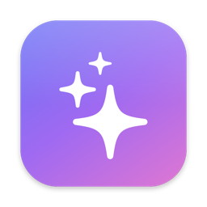
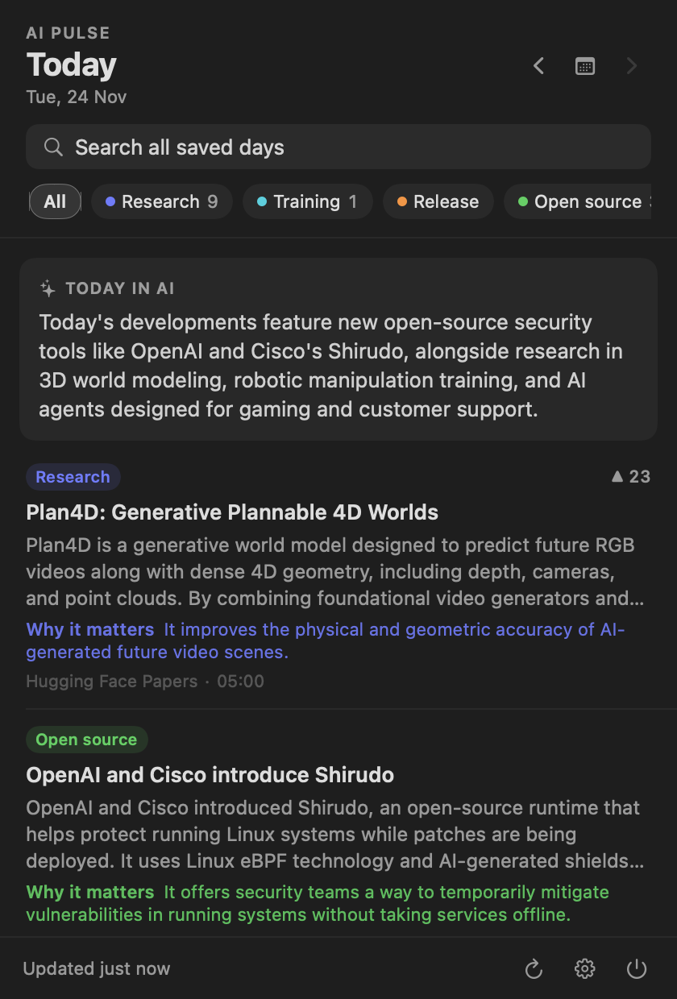
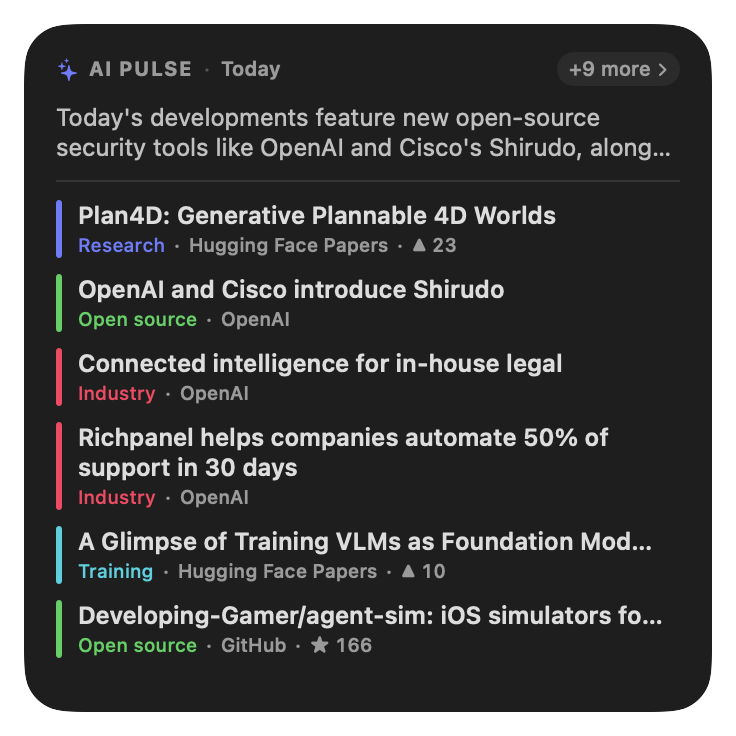
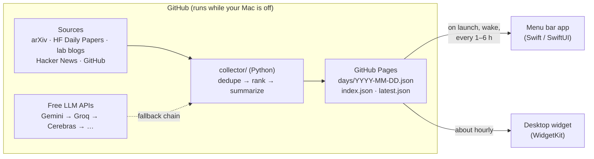

<p align="center">
  
</p>

<h1 align="center">AI Pulse</h1>

<p align="center">
  A daily digest of what happened in AI (new papers, training methods, model releases, tools and industry news) in your Mac's menu bar and on your desktop.<br>
  Every story gets a short, plain-language summary. Every day is saved, so you can look back.
</p>

<p align="center">
  
  &nbsp;
  
</p>

## Install

Needs macOS 14 Sonoma or later, on Apple Silicon or Intel. There's nothing to configure and no API keys.

1. **Download** `AI-Pulse-x.y.z.dmg` from the [latest release](https://github.com/TurdiyevIslombek/news_tracker/releases/latest), open it, and drag **AI Pulse** onto **Applications**.
2. **Open it once.** AI Pulse is free and isn't signed with a paid Apple Developer ID, so macOS stops the first launch with a "can't verify" warning. That's expected:
   - **macOS 15 or later:** open **System Settings → Privacy & Security**, scroll down, and click **Open Anyway** next to AI Pulse.
   - **macOS 14:** right-click AI Pulse in Applications → **Open** → **Open**.
3. **Add the widget:** right-click the desktop → **Edit Widgets…** → search **AI Pulse** → pick a size.

The ✦ icon in the menu bar opens today's digest. Click a story to read it; click the widget for the full list.

<details>
<summary>Prefer the terminal or Homebrew?</summary>

```bash
# Skip step 2 by clearing the download quarantine yourself:
xattr -dr com.apple.quarantine "/Applications/AI Pulse.app"
```

```bash
# Or install with Homebrew (this repo is also a tap):
brew tap TurdiyevIslombek/news_tracker https://github.com/TurdiyevIslombek/news_tracker
brew install --cask ai-pulse
```
</details>

## What you get

- **Menu bar popover:** today's headline ("Today in AI") and the top ~15 stories. Browse past days with ← / → or the calendar, filter by category, and search every saved day.
- **Desktop widget** in three sizes: the headline (small), the top 3 (medium), or the headline plus the top 6 (large).
- **Five categories,** each with a subtle accent color: Research, Training method, Model release, Tool / Open source and Industry.
- **Works offline.** Every day is cached, and when your Mac wakes it catches up on any days it missed.
- **No accounts, no tracking, no keys in the app.** It only downloads static JSON.

## How it works



- **The collector (the brain)** is a [GitHub Actions workflow](.github/workflows/collect.yml) that runs every 6 hours. It fetches every source, merges duplicates (the same paper on arXiv, HF and HN becomes one item with all its signals), ranks them with a [simple documented score](collector/rank.py), and summarizes the top stories through a chain of free LLM APIs. If one provider is rate-limited or down, the next takes over. If every provider is down, the stories still publish with their abstracts and get summarized on a later run, so a day is never missing. API keys live only in Actions secrets.
- **The Mac app (the face)** only downloads and displays the JSON. It holds no keys and makes no LLM calls.
- **Dates** in the feed are UTC days. The app shows times in your local time zone.

## Run your own feed

Want different sources, a different ranking, or your own LLM keys? Fork the repo; it costs nothing.

1. **Fork** this repo.
2. **Turn on Pages:** in your fork go to **Settings → Pages**, set **Source: GitHub Actions**, then open **Actions** and enable workflows.
3. **Add at least one free LLM key:** go to **Settings → Secrets and variables → Actions → New repository secret**. One key is enough; more keys make the feed more reliable when a provider is busy.

   | Secret | Where to get it (free) | Notes |
   |---|---|---|
   | `GEMINI_API_KEY` | [Google AI Studio](https://aistudio.google.com/apikey) | The default first choice. One key covers three Gemini models. |
   | `GROQ_API_KEY` | [Groq console](https://console.groq.com/keys) | `gpt-oss-120b`, about 1,000 requests a day. The best second key. |
   | `OPENROUTER_API_KEY` | [OpenRouter](https://openrouter.ai/keys) | `:free` models. |
   | `CEREBRAS_API_KEY` | [Cerebras](https://cloud.cerebras.ai) | A $5 trial credit that lasts 30 days, not a permanent free tier. |
   | `MISTRAL_API_KEY` | [Mistral](https://console.mistral.ai) | Check its current free tier. |

4. **Run it:** go to **Actions → collect → Run workflow**. A few minutes later, `https://<you>.github.io/<repo>/latest.json` serves your feed.
5. **Point the app at it:** open the popover → ⚙︎ → **Feed URL** → `https://<you>.github.io/<repo>/`. The widget follows the same setting.

Everything tunable is in [`collector/config.yaml`](collector/config.yaml): sources, ranking weights, how many stories each source can place in the top list, the labs list, and the LLM provider chain. Free tiers and model names change often, so check which providers work with:

```bash
python -m collector providers
```

<details>
<summary>Keeping the schedule alive</summary>

GitHub pauses scheduled workflows in public repos after 60 days without activity. The collector commits data every run and re-enables its own schedule, so that shouldn't happen. GitHub can still delay or skip individual scheduled runs; when that happens, the next run files the skipped day's news under the day it was published.
</details>

## Add a source

1. Create `collector/sources/mysource.py` with a `Source` subclass whose `fetch(since)` returns `list[RawItem]`. Use `ids.canonical_id(url)` for the id, so the item dedupes with the other sources.
2. Register it in [`collector/sources/__init__.py`](collector/sources/__init__.py) (`REGISTRY`).
3. Add a `mysource:` block under `sources:` in `config.yaml`. That block is passed to your class as `self.cfg`.

A source that throws is logged and skipped, so one broken feed can't break the run. Use official APIs or RSS, and respect each site's terms and rate limits.

## Build from source

You only need the Xcode Command Line Tools (`xcode-select --install`); full Xcode isn't required.

```bash
app/scripts/build.sh                    # → app/build/AI Pulse.app (universal, ad-hoc signed)
open "app/build/AI Pulse.app"
app/scripts/test.sh                     # app tests against real feed fixtures
app/scripts/package-dmg.sh              # → app/build/AI-Pulse-<version>.dmg
```

```bash
# The collector, locally:
uv venv -p 3.13 .venv && uv pip install -p .venv -r collector/requirements-dev.txt
echo 'GEMINI_API_KEY=...' > .env        # any one provider key is enough
.venv/bin/python -m collector run       # writes docs/days/YYYY-MM-DD.json
.venv/bin/python -m pytest collector/tests
```

Releases are built by [`release.yml`](.github/workflows/release.yml): push a tag like `v0.2.0`, and GitHub builds the `.dmg`, attaches it to a release, and updates the Homebrew cask.

<details>
<summary>Troubleshooting</summary>

- **The widget isn't in Edit Widgets.** Open AI Pulse once (macOS only registers a widget after its app has run), then reopen Edit Widgets. Keep only one copy of AI Pulse on your Mac.
- **A story says "Summary pending."** Every free LLM was busy during that run. The story is summarized on a later run, and the app picks it up automatically.
- **The widget shows yesterday.** Feed days are UTC, so early in your morning the newest day may still be "yesterday" until the next collector run.
</details>

## JSON feed

`days/YYYY-MM-DD.json`, `latest.json` (the newest day) and `index.json` (every day) are versioned with `schema_version`. A day has a `headline`, `items` (`title`, `url`, `source`, `category`, `summary`, `why_it_matters`, `score`, `signals`, `published_at`, `summarized_by`, `summary_status`) and lighter `more` items. See [a live example](https://turdiyevislombek.github.io/news_tracker/latest.json).
